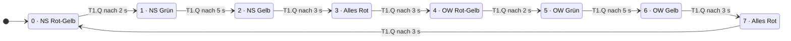

# Ampelsteuerung (SPS / Structured Text)

Ampelsteuerung einer Kreuzung als Zustandsautomat, programmiert in **Structured Text nach IEC 61131-3** mit dem OpenPLC Editor.

Aktuelle Version: **Kreuzung mit zwei verriegelten Fahrtrichtungen** (Nord-Süd und Ost-West). Die einfache Erstversion mit einer Richtung bleibt in der Git-Historie erhalten.

---

## Funktion

Eine gemeinsame Zustandsmaschine schaltet beide Richtungen durch acht Phasen. Grün tritt je Richtung nur in genau einer Phase auf — beide Richtungen können strukturell nie gleichzeitig Grün haben. Zwischen den Richtungswechseln liegt jeweils eine Alles-Rot-Phase als Räumzeit.

| Schritt | Nord-Süd | Ost-West | Dauer |
|--------:|----------|----------|:-----:|
| 0 | Rot-Gelb | Rot | 2 s |
| 1 | Grün | Rot | 5 s |
| 2 | Gelb | Rot | 3 s |
| 3 | Rot | Rot | 3 s |
| 4 | Rot | Rot-Gelb | 2 s |
| 5 | Rot | Grün | 5 s |
| 6 | Rot | Gelb | 3 s |
| 7 | Rot | Rot | 3 s |

**Umlaufzeit: 26 s.**

---

## Zustandsdiagramm



Alle Übergänge sind rein zeitgesteuert — der Automat läuft ohne äußere Eingänge im Kreis. Eine ereignisgesteuerte Variante mit Anforderungstaster ist im Projekt [fussgaenger-ampel](https://github.com/kevin-wiesner/fussgaenger-ampel) umgesetzt.

---

## Signalliste

Das Projekt läuft im **OpenPLC-Simulator**, es ist kein Pin-Mapping auf physische Hardware hinterlegt. Alle Signale sind Ausgänge; Eingänge gibt es in dieser Version nicht.

| Variable | Typ | Richtung | Bedeutung |
|---|---|---|---|
| `NS_Rot` | `BOOL` | Ausgang | Rot Nord-Süd |
| `NS_Gelb` | `BOOL` | Ausgang | Gelb Nord-Süd |
| `NS_Gruen` | `BOOL` | Ausgang | Grün Nord-Süd |
| `OW_Rot` | `BOOL` | Ausgang | Rot Ost-West |
| `OW_Gelb` | `BOOL` | Ausgang | Gelb Ost-West |
| `OW_Gruen` | `BOOL` | Ausgang | Grün Ost-West |
| `Schritt` | `INT` | intern | aktuelle Phase 0–7 |
| `T_Zeit` | `TIME` | intern | Dauer der aktuellen Phase |
| `T1` | `TON` | intern | Phasentimer, Instanz mit eigenem Speicher |

**Bei Zuordnung auf echte Hardware** würden die sechs Ausgänge auf digitale Ausgangsklemmen gelegt (`%QX0.0` bis `%QX0.5`). Die internen Variablen bleiben Merker ohne Adresse.

---

## Technik

- **Zustandsautomat** über `CASE Schritt OF ... END_CASE`
- **Ein einziger `TON`-Timer** für alle Phasen, mit Selbstreset über `IN := NOT T1.Q`. Die Phasendauer `T_Zeit` wird im jeweiligen Schritt gesetzt.
- **Grundstellung auf sicheren Zustand:** Zu Beginn jedes Zyklus werden alle Lampen auf Rot gesetzt, danach setzt die aktive Phase nur ihre Abweichungen. Fällt ein Schritt aus der Logik, steht die Anlage auf Rot statt auf undefiniert.
- **Zweistufige Sicherheitsverriegelung** nach dem `CASE` (siehe unten)

### Die Verriegelung — und warum sie zweistufig ist

```pascal
(* 3a) Nie beide Richtungen gleichzeitig gruen *)
IF NS_Gruen AND OW_Gruen THEN ... END_IF;

(* 3b) Nie Rot und Gruen derselben Richtung gleichzeitig *)
IF NS_Rot AND NS_Gruen THEN NS_Gruen := FALSE; END_IF;
IF OW_Rot AND OW_Gruen THEN OW_Gruen := FALSE; END_IF;
```

Ursprünglich gab es nur Prüfung **3a**. Die kann strukturell gar nicht auslösen, weil jede Richtung nur in genau einer Phase Grün setzt — sie beruhigte, ohne zu schützen.

Der Fehler, der tatsächlich im Programm steckte, war ein anderer: In Schritt 1 stand `NS_Rot := TRUE` statt `FALSE`, wodurch Nord-Süd fünf Sekunden lang **Rot und Grün gleichzeitig** zeigte. Prüfung 3a sah das nicht. Prüfung **3b** fängt genau diesen Fall ab.

Der Lernpunkt daraus: Eine Verriegelung ist nur so gut wie die Fehlerfälle, die sie überhaupt prüfen kann. Sie muss auf den Fehler zielen, der auftreten kann — nicht auf den, der theoretisch schlimm wäre.

---

## Ausführen

1. Projekt im OpenPLC Editor öffnen
2. Kompilieren und Simulation starten
3. Variablen `Schritt`, `NS_*` und `OW_*` in den Debugger holen
4. Ein vollständiger Umlauf dauert 26 Sekunden

---

## Geplante Erweiterungen

- Nachtblinken (Gelb blinkend)
- Fußgängerphase in die Kreuzung integrieren

---

## Hintergrund

Übungsprojekt im Rahmen meiner Vorbereitung auf die Industrieautomation. Das Muster aus Zustandsautomat, Timer und Verriegelung ist IEC-61131-3-Standard und überträgt sich direkt auf andere Systeme, etwa Siemens SCL.
