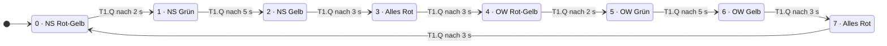

# Ampelsteuerung (SPS / Structured Text)

Ampelsteuerung einer Kreuzung als Zustandsautomat, programmiert in **Structured Text nach IEC 61131-3** mit dem OpenPLC Editor.

Aktuelle Version: **Kreuzung mit zwei verriegelten Fahrtrichtungen** (Nord-Süd und Ost-West). Die einfache Erstversion mit einer Richtung bleibt in der Git-Historie erhalten.

---

## Funktion

Eine gemeinsame Zustandsmaschine schaltet beide Richtungen durch acht Phasen. Grün tritt je Richtung nur in genau einer Phase auf, deshalb können beide Richtungen nie gleichzeitig Grün haben. Zwischen den Richtungswechseln liegt jeweils eine Alles-Rot-Phase als Räumzeit.

| Schritt | Nord-Süd | Ost-West | Dauer |
|--------:|----------|----------|:-----:|
| 0 | Rot-Gelb | Rot | 2 s |
| 1 | Grün | Rot | 5 s |
| 2 | Gelb | Rot | 3 s |
| 3 | Rot | Rot | 3 s |
| 4 | Rot | Rot-Gelb | 2 s |
| 5 | Rot | Grün | 5 s |
| 6 | Rot | Gelb | 3 s |
| 7 | Rot | Rot | 3 s |

**Umlaufzeit: 26 s.**

---

## Zustandsdiagramm



Alle Übergänge sind rein zeitgesteuert, der Automat läuft ohne äussere Eingänge im Kreis. Eine ereignisgesteuerte Variante mit Anforderungstaster ist im Projekt [fussgaenger-ampel](https://github.com/kevin-wiesner/fussgaenger-ampel) umgesetzt.

---

## Signalliste

Das Projekt ist für den **OpenPLC-Simulator** angelegt, es ist kein Pin-Mapping auf physische Hardware hinterlegt. Alle Signale sind Ausgänge; Eingänge gibt es in dieser Version nicht.

| Variable | Typ | Richtung | Bedeutung |
|---|---|---|---|
| `NS_Rot` | `BOOL` | Ausgang | Rot Nord-Süd |
| `NS_Gelb` | `BOOL` | Ausgang | Gelb Nord-Süd |
| `NS_Gruen` | `BOOL` | Ausgang | Grün Nord-Süd |
| `OW_Rot` | `BOOL` | Ausgang | Rot Ost-West |
| `OW_Gelb` | `BOOL` | Ausgang | Gelb Ost-West |
| `OW_Gruen` | `BOOL` | Ausgang | Grün Ost-West |
| `Schritt` | `INT` | intern | aktuelle Phase 0–7 |
| `T_Zeit` | `TIME` | intern | Dauer der aktuellen Phase |
| `T1` | `TON` | intern | Phasentimer, Instanz mit eigenem Speicher |

**Bei Zuordnung auf echte Hardware** würden die sechs Ausgänge auf digitale Ausgangsklemmen gelegt (`%QX0.0` bis `%QX0.5`). Die internen Variablen bleiben Merker ohne Adresse.

---

## Technik

- **Zustandsautomat** über `CASE Schritt OF ... END_CASE`
- **Ein einziger `TON`-Timer** für alle Phasen, mit Selbstreset über `IN := NOT T1.Q`. Die Phasendauer `T_Zeit` wird im jeweiligen Schritt gesetzt.
- **Grundstellung auf sicheren Zustand:** Zu Beginn jedes Zyklus werden alle Lampen auf Rot gesetzt, danach setzt die aktive Phase nur ihre Abweichungen. Fällt ein Schritt aus der Logik, steht die Anlage auf Rot statt auf undefiniert.
- **Zweistufige Sicherheitsverriegelung** nach dem `CASE` (siehe unten)

### Warum die Verriegelung zweistufig ist

```pascal
(* 3a) Nie beide Richtungen gleichzeitig gruen *)
IF NS_Gruen AND OW_Gruen THEN ... END_IF;

(* 3b) Nie Rot und Gruen derselben Richtung gleichzeitig *)
IF NS_Rot AND NS_Gruen THEN NS_Gruen := FALSE; END_IF;
IF OW_Rot AND OW_Gruen THEN OW_Gruen := FALSE; END_IF;
```

Ursprünglich gab es nur Prüfung **3a**. Die kann strukturell gar nicht auslösen, weil jede Richtung nur in genau einer Phase Grün setzt. Sie hat beruhigt, aber nichts geschützt.

Der Fehler, der tatsächlich im Programm steckte, war ein anderer: In Schritt 1 stand `NS_Rot := TRUE` statt `FALSE`, wodurch Nord-Süd fünf Sekunden lang **Rot und Grün gleichzeitig** zeigte. Prüfung 3a sah das nicht. Prüfung **3b** fängt genau diesen Fall ab.

---

## Fehlersuche: Rot und Grün gleichzeitig

**Symptom.** Nord-Süd zeigte in Phase 1 gleichzeitig Rot und Grün, und zwar über die vollen fünf Sekunden der Grünphase. Ost-West verhielt sich unauffällig.

**Eingrenzen.** Zwei Beobachtungen halfen sofort weiter. Erstens trat der Fehler nur in einer Richtung auf, also lag er nicht in der Grundstellung und nicht im Timer, die für beide Richtungen gemeinsam sind. Zweitens trat er nur in einer Phase auf, nicht über den ganzen Umlauf. Damit war der Suchraum auf den Schritt-1-Zweig des `CASE` eingegrenzt, vier Zeilen Code.

**Ursache.** Dort stand:

```pascal
1: (* NS Gruen *)
NS_Rot := TRUE; NS_Gruen := TRUE;
```

Die Grundstellung vor dem `CASE` setzt bereits alle Lampen auf Rot. Der Schritt soll das für seine Richtung *aufheben*, also `NS_Rot := FALSE` setzen. Stattdessen wurde die Grundstellung wiederholt: Rot blieb an, Grün kam dazu.

**Warum es nicht aufgefallen ist.** Die vorhandene Verriegelung prüfte nur, ob beide Richtungen gleichzeitig Grün sind. Dieser Fall kann strukturell gar nicht eintreten, weil jede Richtung nur in genau einer Phase Grün setzt. Die Prüfung hat also nie ausgelöst und dabei den Eindruck erweckt, die Anlage sei abgesichert.

**Korrektur.** Zwei Änderungen:

```pascal
NS_Rot := FALSE; NS_Gruen := TRUE;      (* Ursache behoben *)

IF NS_Rot AND NS_Gruen THEN             (* zweite Prüfung ergänzt *)
    NS_Gruen := FALSE;
END_IF;
```

**Was ich daraus gelernt habe.** Eine Verriegelung muss auf den Fehler zielen, der wirklich auftreten kann. Und dass eine Prüfung nie auslöst, heisst nicht, dass alles in Ordnung ist. Es kann auch heissen, dass sie das Falsche prüft.

---

## Testplan

Testfälle für den OpenPLC-Simulator: Variablen im Debugger beobachten.

| Nr. | Testfall | Erwartetes Verhalten |
|---:|---|---|
| 1 | Kaltstart | `Schritt = 0`, NS Rot und Gelb, OW Rot |
| 2 | Nach 2 s | Wechsel auf `Schritt = 1` |
| 3 | Während Schritt 1 | `NS_Rot = FALSE`, `NS_Gruen = TRUE` |
| 4 | Während Schritt 1 | OW komplett Rot |
| 5 | Nach 5 s | Wechsel auf `Schritt = 2`, NS Gelb |
| 6 | Schritt 3 | alle sechs Ausgänge Rot, Dauer 3 s |
| 7 | Schritte 4 bis 7 | spiegelbildlich zu 0 bis 3, Rollen vertauscht |
| 8 | Schritt 7 → 0 | Umlauf schliesst sich, kein Hängenbleiben |
| 9 | Vollständiger Umlauf | Gesamtdauer ca. 26 s |
| 10 | Über zwei volle Umläufe | zu keinem Zeitpunkt `NS_Gruen AND OW_Gruen` |
| 11 | Über zwei volle Umläufe | zu keinem Zeitpunkt Rot und Grün derselben Richtung |
| 12 | Verriegelung 3a auslösen: in Schritt 1 vorübergehend `OW_Gruen := TRUE;` ergänzen | beide Richtungen fallen auf Rot |
| 13 | Verriegelung 3b auslösen: in Schritt 1 vorübergehend `NS_Rot := TRUE;` setzen (der ursprüngliche Fehler) | `NS_Gruen` wird zurückgesetzt, NS zeigt nur Rot |

Die Testfälle 12 und 13 lösen die Verriegelung über eine vorübergehende Codeänderung aus statt über Forcen im Debugger, weil die Grundstellung am Zyklusanfang die Ausgänge in jedem Zyklus neu setzt. Nach dem Test die Zeile wieder entfernen.

Die Testfälle 12 und 13 prüfen die Verriegelung selbst. Eine Prüfung, die im Normalbetrieb nie auslöst, wird sonst gar nicht getestet.

---

## Ausführen

1. Projekt im OpenPLC Editor öffnen
2. Kompilieren und Simulation starten
3. Variablen `Schritt`, `NS_*` und `OW_*` in den Debugger holen
4. Ein vollständiger Umlauf dauert ca. 26 Sekunden

---

## Geplante Erweiterungen

- Nachtblinken (Gelb blinkend)
- Fussgängerphase in die Kreuzung integrieren

---

## Hintergrund

Übungsprojekt im Rahmen meiner Vorbereitung auf die Industrieautomation. Das Muster aus Zustandsautomat, Timer und Verriegelung ist IEC-61131-3-Standard und überträgt sich direkt auf andere Systeme, etwa Siemens SCL.
